<!-- Every card is an animated SVG drawn by scripts/render.py and refreshed daily by
     .github/workflows/update-cards.yml. Spacing is baked into the SVGs, so keep this block
     free of blank lines and keep each row of cards on one line with no spaces between them. -->

 
 
 
 
 
 
 
 

<a href="https://tanmay-portfolio-fsd.vercel.app">portfolio</a> &nbsp;/&nbsp; <a href="https://www.linkedin.com/in/tanmay-mahajan-220ab826b">linkedin</a> &nbsp;/&nbsp; <a href="mailto:tanmay261006@gmail.com">email</a> &nbsp;/&nbsp; <a href="https://www.instagram.com/tanmaymahajan26">instagram</a>

