<!-- Every card is an animated SVG drawn by scripts/render.py and refreshed daily by
     .github/workflows/update-cards.yml. Spacing is baked into the SVGs, so keep this block
     free of blank lines and keep each row of cards on one line with no spaces between them. -->

<a href="https://tanmay-portfolio-fsd.vercel.app"></a> 
 
 
<a href="https://github.com/TanmayMahajan26?tab=repositories"></a><a href="https://github.com/TanmayMahajan26/CODEISSANCE_26_Skill-Issue"></a><a href="https://www.linkedin.com/in/tanmay-mahajan-220ab826b"></a> 
<picture><source media="(prefers-color-scheme: dark)" srcset="./cards/title-dark.svg" /></picture> 
<a href="https://github.com/TanmayMahajan26/CODEISSANCE_26_Skill-Issue"></a><a href="https://github.com/TanmayMahajan26/Synapse"></a><a href="https://github.com/TanmayMahajan26/zenthera-ml"></a> 
<a href="https://github.com/TanmayMahajan26/Team-Pocket-Aces-Bharatiya-Antariksh-Hackathon-2026-ISRO"></a><a href="https://github.com/TanmayMahajan26/Skill-Issue-Airavat-3.0"></a><a href="https://github.com/TanmayMahajan26/Ecosentinel"></a>

<a href="https://tanmay-portfolio-fsd.vercel.app">portfolio</a> &nbsp;/&nbsp; <a href="https://www.linkedin.com/in/tanmay-mahajan-220ab826b">linkedin</a> &nbsp;/&nbsp; <a href="mailto:tanmay261006@gmail.com">email</a> &nbsp;/&nbsp; <a href="https://www.instagram.com/tanmaymahajan26">instagram</a>

